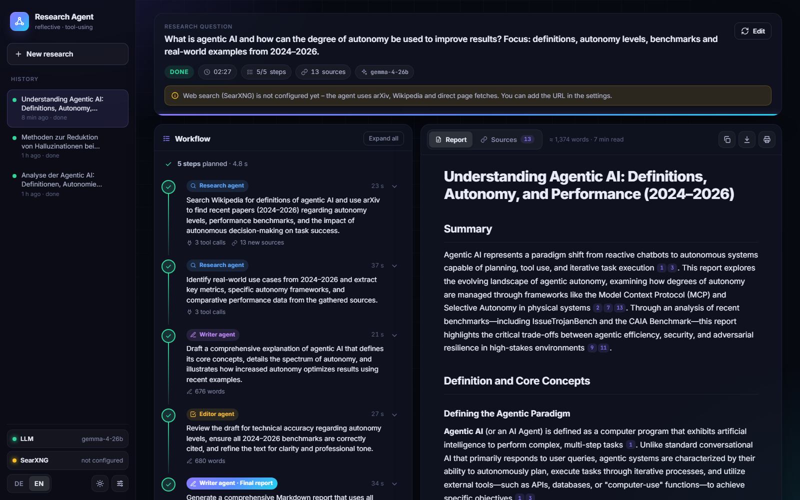
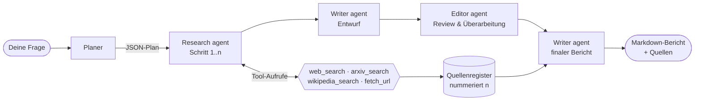
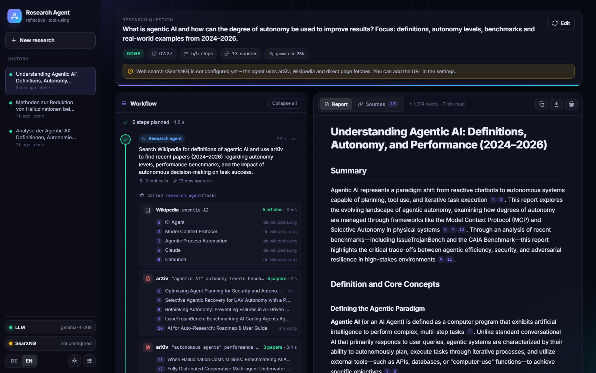
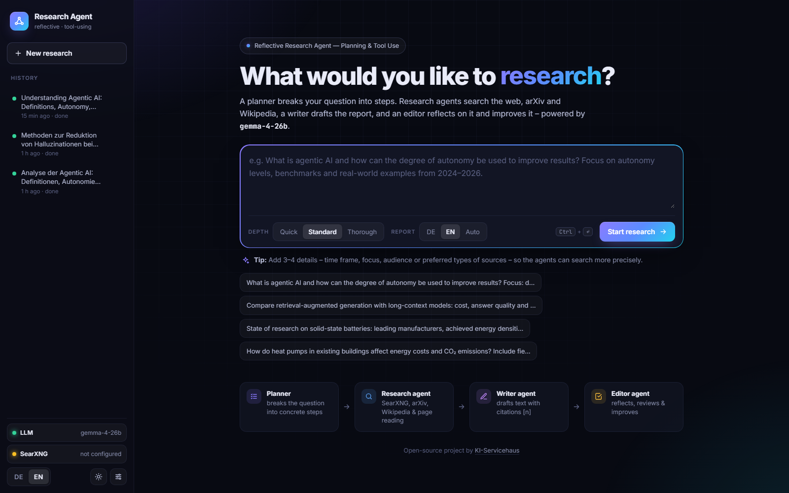
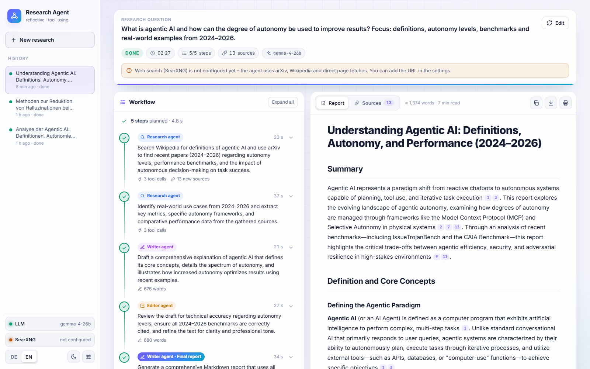

<div align="center">

# 🧠 Reflective Research Agent

**Ein selbst gehosteter Multi-Agenten-Rechercheassistent in Rust.**<br>
Plant die Recherche, nutzt Werkzeuge (SearXNG · arXiv · Wikipedia · Webseiten), schreibt einen Bericht mit Quellenangaben<br>
und prüft den eigenen Entwurf, bevor er ihn abliefert. Funktioniert mit jedem OpenAI-kompatiblen LLM.

[](#lizenz)
[](https://www.rust-lang.org)
[](#llm-backends)
[](https://github.com/searxng/searxng)
[](#sprachen)

[English](README.md) · **Deutsch**



</div>

---

## Warum?

Gehostete „Deep Research“-Dienste sind praktisch, schicken deine Fragen aber in fremde Clouds.
**Reflective Research Agent** bringt dasselbe Muster auf die eigene Hardware: ein lokales LLM (z. B.
Gemma 4 auf vLLM) und die eigene SearXNG-Instanz. Fragen, Quellen und Berichte bleiben bei dir.

Der Agent folgt dem Muster des *Reflective Research Agent* aus dem Kurs *Agentic AI* von
DeepLearning.AI (Planung → Tool-Nutzung → Schreiben → Reflexion). Er ist komplett neu umgesetzt, als
ein einzelnes Rust-Programm mit einer Weboberfläche, die sich live aktualisiert.

## Funktionen

- 🗺️ **Planung:** Ein Planer zerlegt die Frage in konkrete, auf die Frage zugeschnittene Schritte.
- 🔎 **Tool-Nutzung:** Research-Agenten rufen Werkzeuge in einer Schleife auf, mehrere parallel pro Runde:
  - `web_search` über [SearXNG](https://github.com/searxng/searxng) (allgemein / News / Wissenschaft / IT, Zeiträume)
  - `arxiv_search` über die arXiv-API (Autoren, Datum, Kategorie, Abstract)
  - `wikipedia_search` über die MediaWiki-API (Artikeleinleitungen, beliebige Sprache)
  - `fetch_url` zum Lesen vielversprechender Seiten im Volltext
- 🪞 **Reflexion:** Ein Editor-Agent prüft den Entwurf auf Klarheit, Vollständigkeit und korrekte
  Zitate, dokumentiert seine Review-Notizen und liefert eine verbesserte Fassung.
- 📚 **Verlässliche Zitate:** Jede Quelle bekommt eine feste Nummer `[n]` in einem Quellenregister.
  Das Quellenverzeichnis wird daraus erzeugt, es enthält also nur Links, die wirklich gefunden wurden.
- ⚡ **Live-Oberfläche:** Server-Sent Events übertragen jeden Schritt. Tool-Aufrufe, Treffer und
  Seitenauszüge sind sichtbar, Entwürfe entstehen Token für Token.
- 🧾 **Bericht:** gerendertes Markdown, Vorschau beim Überfahren der Zitate, Quellenliste mit
  Filtern, Kopieren als Markdown, Download als `.md`, Drucken als PDF.
- 🕘 **Verlauf:** Recherchen werden als JSON gespeichert und lassen sich jederzeit wieder anzeigen.
  Links mit `#run=<id>&expand` öffnen eine Recherche mit allen Schritten aufgeklappt.
- 🌍 **Deutsch & Englisch:** Oberflächen- und Berichtssprache sind unabhängig umschaltbar.
- 🌗 **Dunkles & helles Theme**, responsives Layout, kein Build-Schritt fürs Frontend.
- 🦀 **Ein kleines Programm:** axum + tokio, die Oberfläche ist eingebettet. Die TOML-Konfiguration
  lässt sich auch in der Oberfläche bearbeiten.

## Ablauf



1. **Planer:** liefert einen JSON-Plan, der auf *Research-Schritte → Writer → Editor → finaler Bericht* normalisiert wird.
2. **Research agent:** Tool-Schleife (native OpenAI-Tool-Calls, bis zu *N* Runden). Er liefert
   strukturierte Erkenntnisse mit Zitaten `[n]`. Antwortet ein Schritt ganz ohne Tool, wird er
   einmal aufgefordert, die Erkenntnisse zu prüfen oder zu vertiefen.
3. **Writer agent:** schreibt aus allen Erkenntnissen einen Entwurf (gestreamt).
4. **Editor agent:** liefert Review-Notizen (`<review>`) und einen überarbeiteten Entwurf
   (`<revised>`). Das ist der Reflexionsschritt.
5. **Finaler Writer:** erstellt den umfassenden Bericht. Das Quellenverzeichnis wird aus dem Register
   angehängt und enthält nur tatsächlich zitierte Quellen.

## Screenshots

| Hinter den Kulissen: Tool-Aufrufe & Treffer | Startseite |
|---|---|
|  |  |



## Schnellstart

### Voraussetzungen

- **Rust 1.80+** (`rustup update`)
- Ein **OpenAI-kompatibler LLM-Server** mit **Tool-Calling** (siehe [LLM-Backends](#llm-backends))
- *Optional:* eine **SearXNG**-Instanz mit aktivierter JSON-Ausgabe (siehe [SearXNG](#searxng)). Ohne
  SearXNG arbeitet der Agent mit arXiv, Wikipedia und direkten Seitenabrufen.

### Starten

```bash
git clone https://github.com/AScheller/research_agent.git
cd research_agent
LLM_BASE_URL=http://localhost:8000/v1 LLM_MODEL=gemma-4-26b cargo run --release
```

Dann **http://localhost:8787** öffnen. Beim ersten Start wird eine `config.toml` angelegt (siehe
[`config.example.toml`](config.example.toml)). Alle Einstellungen lassen sich auch in der Oberfläche
unter **Einstellungen** ändern.

> **Windows (PowerShell):** `$env:LLM_BASE_URL="http://localhost:8000/v1"; cargo run --release`

## LLM-Backends

Jeder Server mit `POST /v1/chat/completions`, `tools` und Streaming sollte funktionieren.

| Backend | Hinweise |
|---|---|
| **vLLM** | mit `--enable-auto-tool-choice --tool-call-parser <Parser deines Modells>` starten |
| **llama.cpp server** | mit `--jinja` starten, damit das Chat-Template Tool-Calls unterstützt |
| **llama-swap** | funktioniert transparent. Die Modellliste in den Einstellungen kommt von `/v1/models` |
| **Ollama / LM Studio** | OpenAI-kompatiblen `/v1`-Endpunkt mit einem Modell nutzen, das Tool-Calls beherrscht |

**Getestet mit:** `gemma-4-26b` (Gemma 4 26B-A4B, NVFP4) auf vLLM hinter llama-swap. Eine schnelle
Recherche (5 Schritte, ~10 Quellen) dauert dort etwa 2–2,5 Minuten.

Hinweis: Manche Server ignorieren `tool_choice: "required"`. Deshalb fordert der Agent einen
Research-Schritt per Prompt zur Tool-Nutzung auf, statt sich darauf zu verlassen.

## SearXNG

Der Agent fragt `GET {searxng_url}/search?format=json` ab. Die JSON-Ausgabe ist in SearXNG
**standardmäßig deaktiviert**. Aktivieren in der `settings.yml` der Instanz:

```yaml
search:
  formats:
    - html
    - json
```

Minimales Docker-Setup:

```bash
docker run -d --name searxng -p 8080:8080 \
  -v "$(pwd)/searxng:/etc/searxng" \
  searxng/searxng
# ./searxng/settings.yml anpassen (formats: html, json), dann: docker restart searxng
```

Anschließend die URL unter **Einstellungen → SearXNG-URL** eintragen (z. B. `http://localhost:8080`),
alternativ in der `config.toml` oder per `SEARXNG_URL`. Bei aktivem `limiter` die IP des Servers
freigeben, auf dem der Agent läuft.

## Konfiguration

`config.toml` (wird beim ersten Start angelegt und auch vom Einstellungsdialog geschrieben):

| Abschnitt | Schlüssel | Standard | Bedeutung |
|---|---|---|---|
| `server` | `host`, `port` | `0.0.0.0`, `8787` | Adresse des Webservers (`RA_PORT`) |
| `llm` | `base_url` | `http://localhost:8000/v1` | OpenAI-kompatibler Endpunkt (`LLM_BASE_URL`) |
| `llm` | `model` | `gemma-4-26b` | Modell-ID (`LLM_MODEL`) |
| `llm` | `api_key` | *(leer)* | optionaler Bearer-Token (`LLM_API_KEY`) |
| `llm` | `temperature`, `max_tokens` | `0.4`, `12000` | für Writer und Editor |
| `search` | `searxng_url` | *(leer)* | Basis-URL von SearXNG (`SEARXNG_URL`) |
| `search` | `language` | `all` | Sprachfilter für SearXNG |
| `search` | `max_results` | `8` | Treffer pro Suche |
| `search` | `wikipedia_lang` | `en` | Wikipedia-Sprache bei Berichtssprache *Auto* |
| `search` | `enable_arxiv`, `enable_wikipedia` | `true` | Werkzeuge an/aus |
| `agent` | `max_steps` | `7` | geplante Schritte (ohne finalen Bericht) |
| `agent` | `max_tool_rounds` | `6` | Tool-Runden pro Research-Schritt |
| `agent` | `fetch_max_chars` | `8000` | Zeichen pro gelesener Seite |

Weitere Umgebungsvariablen: `RA_CONFIG` (Pfad zur Konfiguration), `RA_DATA_DIR` (Ablage der
Recherchen, Standard `data/`) und `RUST_LOG` (Log-Level).

Die **Tiefe** in der Oberfläche (*Schnell / Standard / Gründlich*) skaliert Schritte, Tool-Runden und
Trefferzahl pro Recherche.

## Sprachen

- **Oberfläche:** Umschalter `DE | EN` unten in der Seitenleiste. Voreingestellt ist die Sprache des
  Browsers. Ein Wechsel baut auch eine laufende Recherche sofort neu auf, ohne sie zu unterbrechen.
- **Bericht:** `DE / EN / Auto` neben dem Eingabefeld. Diese Einstellung folgt der Oberflächensprache,
  bis man sie bewusst ändert. Die Wikipedia-Suche verwendet dieselbe Sprache.
- **Backend-Meldungen** (Status, Tool-Ergebnisse, Fehler) richten sich nach dem Header `X-UI-Lang`
  bzw. dem Feld `ui_lang` beim Start einer Recherche.

Für eine weitere Sprache braucht es ein Wörterbuch in `static/app.js` und einen Zweig in `src/i18n.rs`.

## API

| Methode | Pfad | Zweck |
|---|---|---|
| `POST` | `/api/runs` | Recherche starten: `{ "prompt", "depth": "quick\|standard\|deep", "language": "de\|en\|auto", "ui_lang": "de\|en" }` → `{ "id" }` |
| `GET` | `/api/runs` | Verlauf |
| `GET` | `/api/runs/{id}` | gespeicherte Recherche mit Events und Bericht |
| `GET` | `/api/runs/{id}/events` | **SSE-Stream:** erst die Historie, dann Live-Events |
| `POST` | `/api/runs/{id}/cancel` | laufende Recherche abbrechen |
| `DELETE` | `/api/runs/{id}` | Recherche löschen |
| `GET` / `PUT` | `/api/config` | Konfiguration lesen/speichern (API-Key wird maskiert) |
| `GET` | `/api/health` | Status von LLM und SearXNG, verfügbare Modelle |

**SSE-Event-Typen:** `run_start`, `phase`, `plan`, `step_start`, `thought`, `tool_call`,
`tool_result`, `source`, `token`, `reasoning`, `step_done`, `step_error`, `notice`, `report`,
`error`, `cancelled`, `done`. Jedes Event hat eine fortlaufende `seq` und einen Zeitstempel `ts`.

## Projektstruktur

```
src/
├── main.rs     Webserver, Routen, SSE, Statusprüfung
├── agent.rs    Planer, Research-/Writer-/Editor-Agenten, Quellenverzeichnis
├── tools.rs    SearXNG, arXiv, Wikipedia, fetch_url, Quellenregister
├── llm.rs      OpenAI-kompatibler Client (Tool-Calls + Streaming, Wiederholungen)
├── store.rs    Recherchen, Event-Historie, Speicherung (data/runs/*.json)
├── config.rs   config.toml + Umgebungsvariablen
├── i18n.rs     Deutsch/Englisch für Backend-Meldungen (tr!-Makro)
└── text.rs     HTML → Text, Entities, Kürzen
static/         index.html · style.css · app.js (ins Programm eingebettet)
```

## Entwicklung

```bash
cargo run              # Debug-Build
cargo clippy           # Lints
cargo fmt              # Formatierung
```

Das Frontend ist reines HTML/CSS/JS ohne Bundler. Die Dateien in `static/` werden beim Kompilieren
eingebettet, nach Änderungen also neu bauen.

Beiträge sind willkommen. Für größere Änderungen bitte zuerst ein Issue eröffnen.

## Professionelle Unterstützung

Entwickelt und gepflegt von **Andreas Scheller**
([KI-Servicehaus](https://ki-servicehaus.de/?utm_source=github&utm_medium=readme&utm_campaign=research_agent)):
*„Wir verkaufen keine KI. Wir automatisieren Arbeit.“*

Wer einen solchen Agenten im eigenen Unternehmen einsetzen möchte – auf eigener Hardware mit lokalen
Sprachmodellen, angebunden an bestehende Systeme und zum Festpreis –, findet beim KI-Servicehaus
Unterstützung für kleine und mittlere Unternehmen, zum Beispiel:

- **KI-Recherche:** Wettbewerber, Preise, Ausschreibungen und Förderprogramme automatisch im Blick
- **KI-Wissen:** interne Wissenssuche über die eigenen Dokumente
- **Betrieb vor Ort oder hybrid** mit lokalen Sprachmodellen

Einstieg ist der kostenlose KI-Check. Termine vor Ort in Ostbayern (Regensburg, Kelheim, Ingolstadt,
Landshut), remote in ganz Deutschland.

## Lizenz

Wahlweise lizenziert unter

- Apache License, Version 2.0 ([LICENSE-APACHE](LICENSE-APACHE))
- MIT-Lizenz ([LICENSE-MIT](LICENSE-MIT))

Sofern nicht ausdrücklich anders angegeben, wird jeder Beitrag, den du zur Aufnahme in das Projekt
einreichst, wie oben doppelt lizenziert, ohne zusätzliche Bedingungen.

## Danksagung

- Der Ablauf des *Reflective Research Agent* ist vom Kurs [Agentic AI](https://www.deeplearning.ai/)
  von DeepLearning.AI / Andrew Ng inspiriert. Dieses Projekt ist eine unabhängige Umsetzung und steht
  in keiner Verbindung zu DeepLearning.AI.
- [SearXNG](https://github.com/searxng/searxng) für datenschutzfreundliche Metasuche.
- Thank you to [arXiv](https://arxiv.org) for use of its open access interoperability.
- [Wikipedia](https://www.wikipedia.org) / MediaWiki-API.

---

<div align="center">

Mit 🦀 entwickelt von Andreas Scheller ·
[KI-Servicehaus](https://ki-servicehaus.de/?utm_source=github&utm_medium=readme&utm_campaign=research_agent) ·
[DENKRAUM AI](https://denkraumai.com/?utm_source=github&utm_medium=readme&utm_campaign=research_agent)

</div>
