<div align="center">

# 🧠 Reflective Research Agent

**A self-hosted, multi-agent research assistant written in Rust.**<br>
Plans the research, uses tools (SearXNG · arXiv · Wikipedia · web pages), writes a cited report<br>
and critiques its own draft before delivering it. Runs against any OpenAI-compatible LLM.

[](#license)
[](https://www.rust-lang.org)
[](#llm-backends)
[](https://github.com/searxng/searxng)
[](#languages)

**English** · [Deutsch](README.de.md)

<a href="https://github.com/AScheller/research_agent/raw/main/docs/demo.mp4">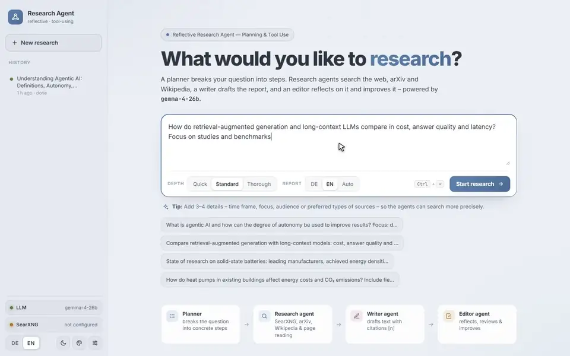</a>

**[▶ Full demo video (MP4, 2:09, download)](https://github.com/AScheller/research_agent/raw/main/docs/demo.mp4)**

</div>

---

## Why?

Hosted "deep research" tools are great, but they send your questions to someone else's cloud.
**Reflective Research Agent** brings the same pattern to your own hardware: a local LLM (e.g. Gemma 4
on vLLM) and your own SearXNG instance. You keep the questions, the sources and the reports.

The agent follows the *reflective research agent* pattern (planning → tool use → writing →
reflection) taught in DeepLearning.AI's *Agentic AI* course, re-implemented from scratch as a
single Rust binary with a polished, live-updating web UI.

## Features

- 🗺️ **Planning:** a planner agent breaks your question into concrete, question-specific steps.
- 🔎 **Tool use:** research agents call tools in a loop, several in parallel per round:
  - `web_search` via [SearXNG](https://github.com/searxng/searxng) (general / news / science / IT, time ranges)
  - `arxiv_search` via the arXiv API (authors, date, category, abstract)
  - `wikipedia_search` via the MediaWiki API (article intros, any language)
  - `fetch_url` to read promising pages in full (readable-text extraction)
- 🪞 **Reflection:** an editor agent reviews the draft for clarity, coverage and citation accuracy,
  documents its review notes and returns an improved version.
- 📚 **Trustworthy citations:** every source gets a fixed number `[n]` in a source registry. The
  reference list is generated from that registry, so it contains only links that were actually found.
- ⚡ **Live UI:** Server-Sent Events stream every step. You can watch tool calls, search hits and
  page excerpts, and see drafts being written token by token.
- 🧾 **Report tools:** rendered Markdown, citation hover cards, source browser with filters,
  copy as Markdown, download `.md`, print to PDF.
- 🕘 **History:** runs are stored as JSON and can be replayed at any time. `#run=<id>&expand` links
  open a run with all steps expanded.
- 🌍 **German & English:** the UI and the report language can be switched independently.
- 🎨 **8 themes:** four palettes (*Graphite*, *Aurora*, *Nord*, *Sepia*), each in dark and light, plus a
  *System* mode that follows your OS. Responsive layout, no frontend build step.
- 🦀 **One small binary:** axum + tokio. The UI is embedded, and a TOML config can also be edited from the UI.

## How it works

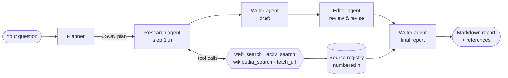

1. **Planner:** returns a JSON plan, which is normalized to *research steps → writer → editor → final report*.
2. **Research agent:** runs a tool loop (native OpenAI tool calling, up to *N* rounds) and returns
   structured findings with `[n]` citations. If a step answers without touching any tool, it is
   nudged once to verify or deepen its findings.
3. **Writer agent:** drafts the report from all findings (streamed).
4. **Editor agent:** writes `<review>` notes and a `<revised>` draft. This is the reflection step.
5. **Final writer:** produces the comprehensive report. The references section is appended from the
   registry and only lists sources that are actually cited.

## Demo & screenshots

**[▶ Demo video (MP4, 2:09, download)](https://github.com/AScheller/research_agent/raw/main/docs/demo.mp4):**
a live run on Gemma 4. It shows planning, tool calls, drafting, review, the final report with
citations, theme switching and the language switch. Waiting times are sped up.

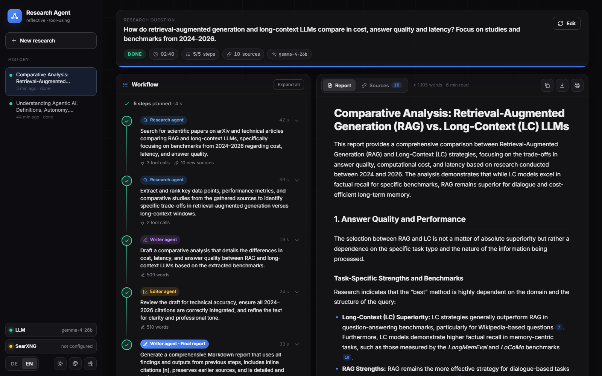

| Behind the scenes: tool calls & hits | Start page |
|---|---|
| 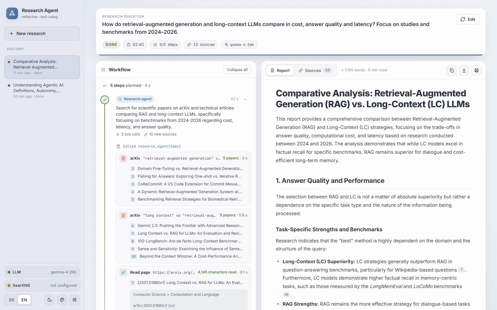 | 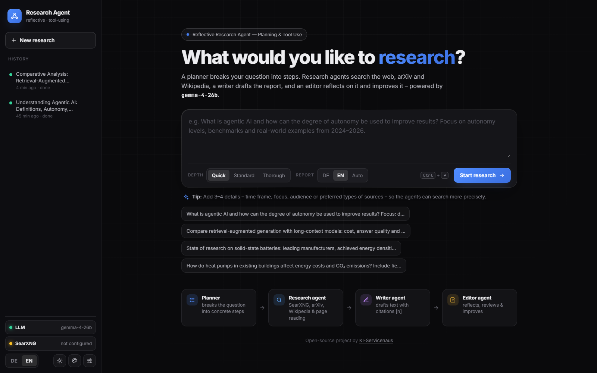 |

### Themes

Pick a theme with the palette button at the bottom of the sidebar. The sun/moon button switches between dark and light.

| | Graphite | Aurora | Nord | Sepia |
|---|---|---|---|---|
| **Dark** |  | 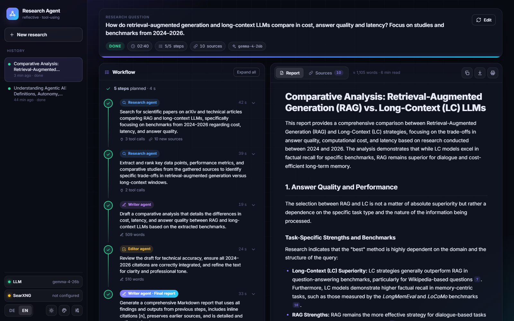 | 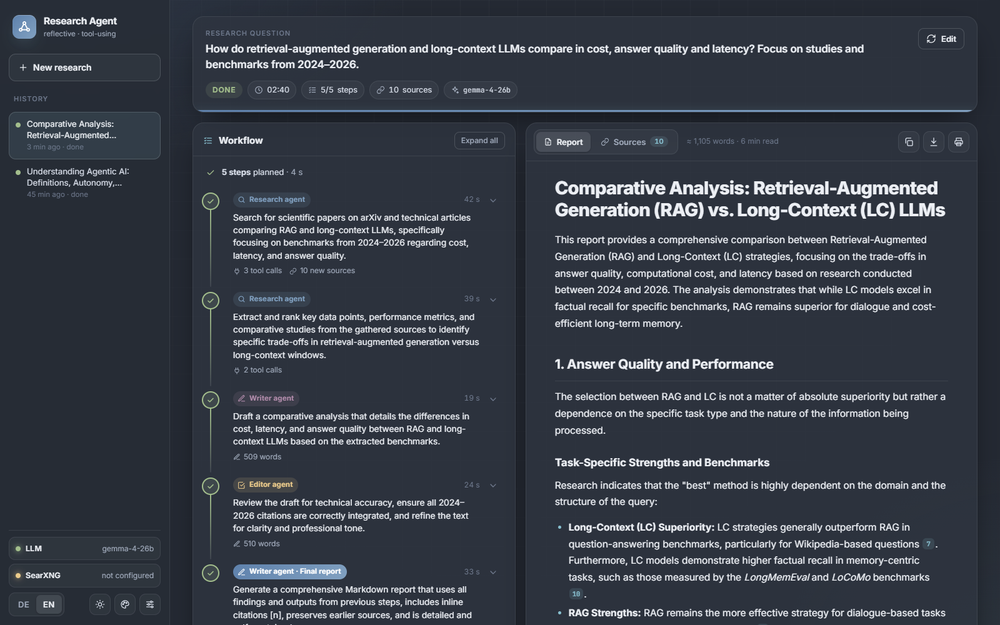 | 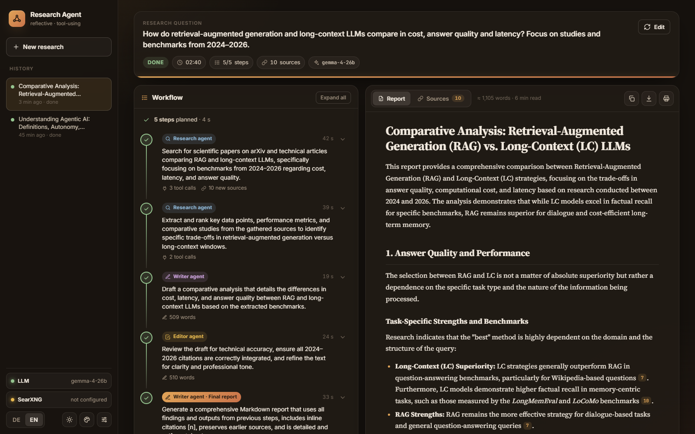 |
| **Light** | 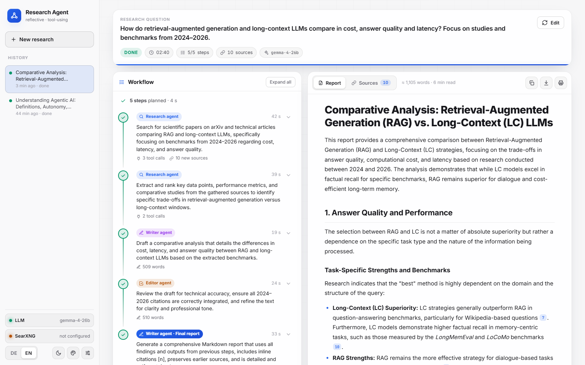 | 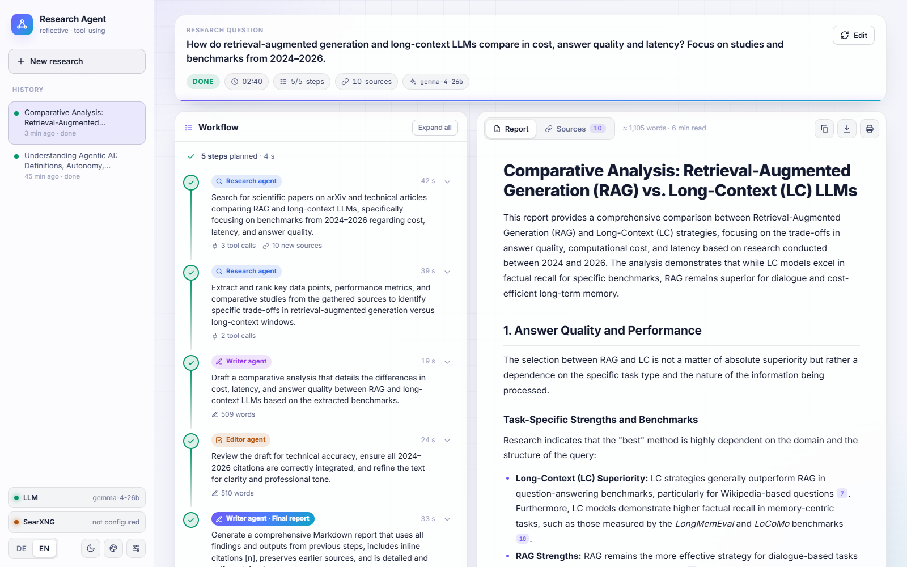 | 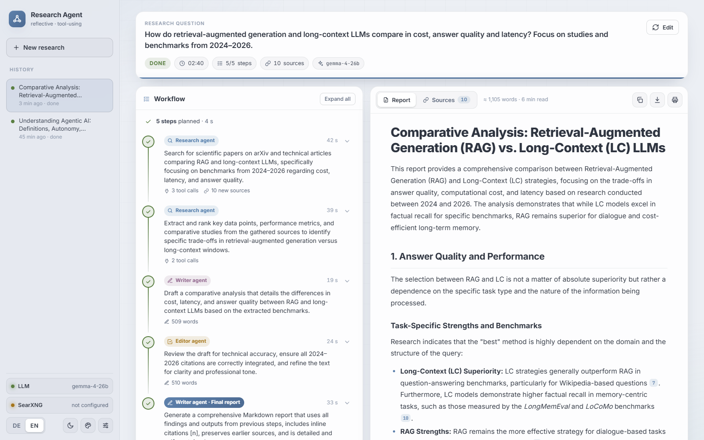 | 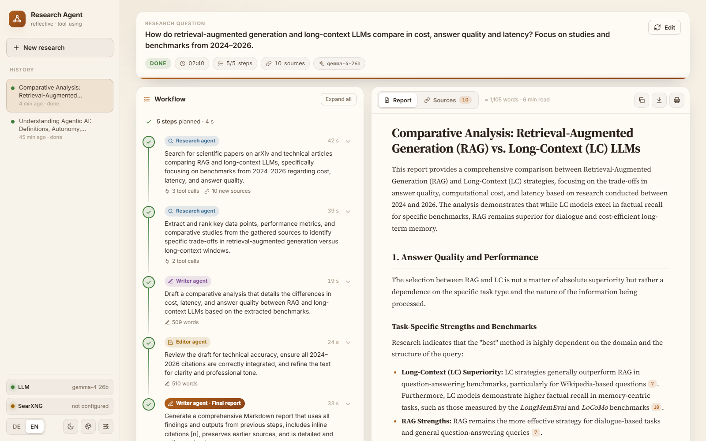 |

## Quick start

### Requirements

- **Rust 1.80+** (`rustup update`)
- An **OpenAI-compatible LLM server** with **tool calling** (see [LLM backends](#llm-backends))
- *Optional:* a **SearXNG** instance with JSON output enabled (see [SearXNG](#searxng)). Without
  it, the agent still works with arXiv, Wikipedia and direct page fetches.

### Run

```bash
git clone https://github.com/AScheller/research_agent.git
cd research_agent
LLM_BASE_URL=http://localhost:8000/v1 LLM_MODEL=gemma-4-26b cargo run --release
```

Open **http://localhost:8787**. On first start a `config.toml` is created (see
[`config.example.toml`](config.example.toml)). Every setting can also be changed in the UI under
**Settings**.

> **Windows (PowerShell):** `$env:LLM_BASE_URL="http://localhost:8000/v1"; cargo run --release`

## LLM backends

Any server that implements `POST /v1/chat/completions` with `tools` (and streaming) should work.

| Backend | Notes |
|---|---|
| **vLLM** | Start with `--enable-auto-tool-choice --tool-call-parser <parser for your model>` |
| **llama.cpp server** | Start with `--jinja` so the chat template supports tool calls |
| **llama-swap** | Works transparently. The model list in Settings comes from `/v1/models` |
| **Ollama / LM Studio** | Use their OpenAI-compatible `/v1` endpoint with a tool-capable model |

**Tested with:** `gemma-4-26b` (Gemma 4 26B-A4B, NVFP4) on vLLM behind llama-swap. A quick research
run (5 steps, ~10 sources) takes about 2–2.5 minutes there.

Note: some servers ignore `tool_choice: "required"`. That's why the agent nudges a research step
through the prompt instead of relying on it.

## SearXNG

The agent queries `GET {searxng_url}/search?format=json`. JSON output is **disabled by default**
in SearXNG, so enable it in your instance's `settings.yml`:

```yaml
search:
  formats:
    - html
    - json
```

Minimal Docker setup:

```bash
docker run -d --name searxng -p 8080:8080 \
  -v "$(pwd)/searxng:/etc/searxng" \
  searxng/searxng
# edit ./searxng/settings.yml (formats: html, json), then: docker restart searxng
```

Then set the URL in **Settings → SearXNG URL** (e.g. `http://localhost:8080`), in `config.toml`, or via
`SEARXNG_URL`. If the bot `limiter` is enabled, allow the IP of the agent's server.

## Configuration

`config.toml` (created on first start, also written by the Settings dialog):

| Section | Key | Default | Description |
|---|---|---|---|
| `server` | `host`, `port` | `0.0.0.0`, `8787` | Listen address (`RA_PORT`) |
| `llm` | `base_url` | `http://localhost:8000/v1` | OpenAI-compatible endpoint (`LLM_BASE_URL`) |
| `llm` | `model` | `gemma-4-26b` | Model ID (`LLM_MODEL`) |
| `llm` | `api_key` | *(empty)* | Optional bearer token (`LLM_API_KEY`) |
| `llm` | `temperature`, `max_tokens` | `0.4`, `12000` | Used by writer and editor |
| `search` | `searxng_url` | *(empty)* | SearXNG base URL (`SEARXNG_URL`) |
| `search` | `language` | `all` | SearXNG language filter |
| `search` | `max_results` | `8` | Results per search |
| `search` | `wikipedia_lang` | `en` | Wikipedia language when the report language is *Auto* |
| `search` | `enable_arxiv`, `enable_wikipedia` | `true` | Enable/disable tools |
| `agent` | `max_steps` | `7` | Planned steps (excluding the final report) |
| `agent` | `max_tool_rounds` | `6` | Tool rounds per research step |
| `agent` | `fetch_max_chars` | `8000` | Characters of a fetched page passed to the model |

Additional environment variables: `RA_CONFIG` (config path), `RA_DATA_DIR` (run storage, default
`data/`) and `RUST_LOG` (log level).

The **depth** selector in the UI (*Quick / Standard / Thorough*) scales the number of steps, tool
rounds and results per run.

## Languages

- **UI language:** `DE | EN` switch at the bottom of the sidebar. It defaults to the browser
  language. Switching re-renders even a running research without interrupting it.
- **Report language:** `DE / EN / Auto` next to the prompt. It follows the UI language until you set
  it explicitly. Wikipedia searches use the same language.
- **Backend messages** (health checks, tool summaries, errors) are localized via the `X-UI-Lang`
  header or the `ui_lang` field when starting a run.

Adding a language means adding one dictionary in `static/app.js` and a branch in `src/i18n.rs`.

## API

| Method | Path | Purpose |
|---|---|---|
| `POST` | `/api/runs` | Start a run: `{ "prompt", "depth": "quick\|standard\|deep", "language": "de\|en\|auto", "ui_lang": "de\|en" }` → `{ "id" }` |
| `GET` | `/api/runs` | List runs (history) |
| `GET` | `/api/runs/{id}` | Stored run including events and report |
| `GET` | `/api/runs/{id}/events` | **SSE stream:** full history first, then live events |
| `POST` | `/api/runs/{id}/cancel` | Cancel a running research |
| `DELETE` | `/api/runs/{id}` | Delete a run |
| `GET` / `PUT` | `/api/config` | Read / update the configuration (API key is masked) |
| `GET` | `/api/health` | LLM and SearXNG status, available models |

**SSE event types:** `run_start`, `phase`, `plan`, `step_start`, `thought`, `tool_call`,
`tool_result`, `source`, `token`, `reasoning`, `step_done`, `step_error`, `notice`, `report`,
`error`, `cancelled`, `done`. Every event carries a monotonically increasing `seq` and a `ts`.

Example:

```bash
curl -s -X POST localhost:8787/api/runs -H 'Content-Type: application/json' \
  -d '{"prompt":"State of research on solid-state batteries","depth":"quick","language":"en"}'
curl -N localhost:8787/api/runs/<id>/events
```

## Project structure

```
src/
├── main.rs     HTTP server, routes, SSE, health checks
├── agent.rs    planner, research / writer / editor agents, references
├── tools.rs    SearXNG, arXiv, Wikipedia, fetch_url, source registry
├── llm.rs      OpenAI-compatible client (tool calls + streaming, retries)
├── store.rs    runs, event history, persistence (data/runs/*.json)
├── config.rs   config.toml + environment overrides
├── i18n.rs     German / English backend messages (tr! macro)
└── text.rs     HTML → text, entities, truncation helpers
static/         index.html · style.css · app.js (embedded into the binary)
```

## Development

```bash
cargo run              # debug build
cargo clippy           # lints
cargo fmt              # formatting
```

The frontend is plain HTML/CSS/JS with no bundler. Files in `static/` are embedded at compile time,
so rebuild after editing them.

### Ideas & roadmap

- PDF reading for arXiv full texts
- More tools (Semantic Scholar, OpenAlex, local documents / RAG)
- Docker image and compose file with SearXNG
- Export to DOCX / HTML

Contributions are welcome. Please open an issue to discuss larger changes first.

## Professional support

Built and maintained by **Andreas Scheller**
([KI-Servicehaus](https://ki-servicehaus.de/?utm_source=github&utm_medium=readme&utm_campaign=research_agent)).

If you want an agent like this running in your company (on your own hardware with local language
models, connected to your existing systems, at a fixed price), KI-Servicehaus helps small and
mid-sized businesses with:

- **Automated research:** keeping track of competitors, prices, tenders and funding programs
- **Internal knowledge search** across your own documents
- **On-premises or hybrid AI setups** with local LLMs

A good starting point is the free *KI-Check*. *Services are offered in German, B2B, for companies in Germany.*

## License

Licensed under either of

- Apache License, Version 2.0 ([LICENSE-APACHE](LICENSE-APACHE) or <http://www.apache.org/licenses/LICENSE-2.0>)
- MIT license ([LICENSE-MIT](LICENSE-MIT) or <http://opensource.org/licenses/MIT>)

at your option.

Unless you explicitly state otherwise, any contribution intentionally submitted for inclusion in
the work by you, as defined in the Apache-2.0 license, shall be dual licensed as above, without any
additional terms or conditions.

## Acknowledgements

- The *reflective research agent* workflow is inspired by the
  [Agentic AI](https://www.deeplearning.ai/) course by DeepLearning.AI / Andrew Ng. This project is
  an independent implementation and is not affiliated with or endorsed by DeepLearning.AI.
- [SearXNG](https://github.com/searxng/searxng) for privacy-respecting metasearch.
- Thank you to [arXiv](https://arxiv.org) for use of its open access interoperability.
- [Wikipedia](https://www.wikipedia.org) / MediaWiki API.

---

<div align="center">

Made with 🦀 by Andreas Scheller ·
[KI-Servicehaus](https://ki-servicehaus.de/?utm_source=github&utm_medium=readme&utm_campaign=research_agent) ·
[DENKRAUM AI](https://denkraumai.com/?utm_source=github&utm_medium=readme&utm_campaign=research_agent)

</div>
